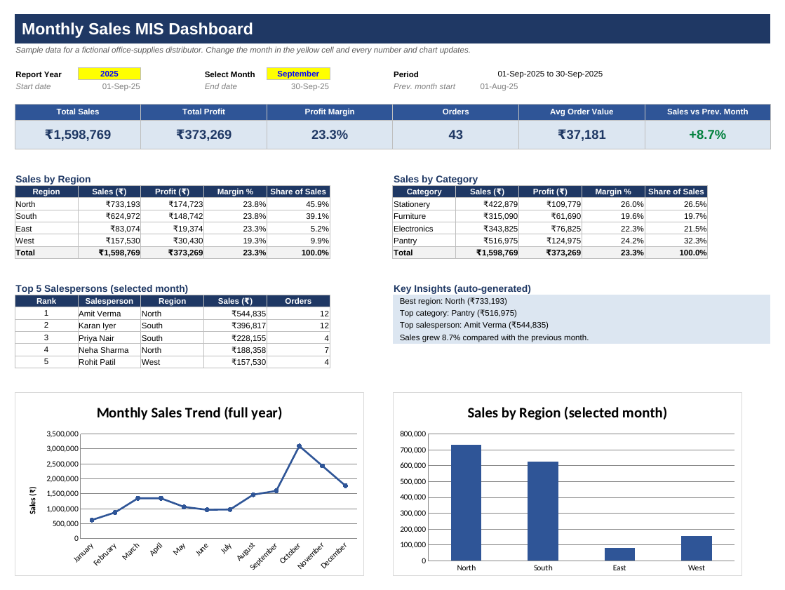

# Monthly Sales MIS Report Automation (Excel)

An Excel MIS reporting workbook that turns raw order data into a one-page management dashboard.
Pick a month from a dropdown and every KPI, table, insight and chart updates automatically — no manual copy-paste.

> **About the data:** the 480 orders, products and prices are **sample data generated for demonstration**
> (a fictional office-supplies distributor). They are not real company data.

## What the workbook does

- **Dashboard** – KPI cards (Total Sales, Profit, Margin, Orders, Average Order Value, change vs previous month),
  sales by region and by category, Top 5 salespersons, auto-written insights and charts for the selected month.
- **Monthly Summary** – full-year table of orders, units, sales, profit, margin and month-on-month growth.
- **Data** – order records. Category, unit price and unit cost are looked up from the product master; sales, cost and profit are calculated.
- **Products / Lists** – product master and dropdown lists.
- **Data Checks** – 12 automatic data-quality and reconciliation checks (missing values, duplicate order IDs, invalid quantities,
  unmapped products, totals that must match) with PASS / REVIEW status.

## How to use

1. Open `Monthly_Sales_MIS_Report.xlsx` and go to the **Dashboard** sheet.
2. Choose a month in the yellow dropdown.
3. To use your own data, paste orders into **Data** columns A–G (blue cells). Columns H–M calculate automatically.
4. Open **Data Checks** and make sure every row says PASS.

## Excel skills demonstrated

`SUMIFS` · `COUNTIFS` · `INDEX / MATCH` lookups · `RANK` · `EOMONTH` / `EDATE` · `SUMPRODUCT` · `IFERROR` ·
data validation (dropdowns) · conditional formatting · charts · formula-driven KPIs · data-quality checks.

## Files

| File | Purpose |
|---|---|
| `Monthly_Sales_MIS_Report.xlsx` | The complete workbook |
| `dashboard_preview.png` | Preview image of the dashboard |

## Author

Piyush Kumar Meena — [LinkedIn](https://linkedin.com/in/piyush-meena) · [GitHub](https://github.com/piyushmeena19)
